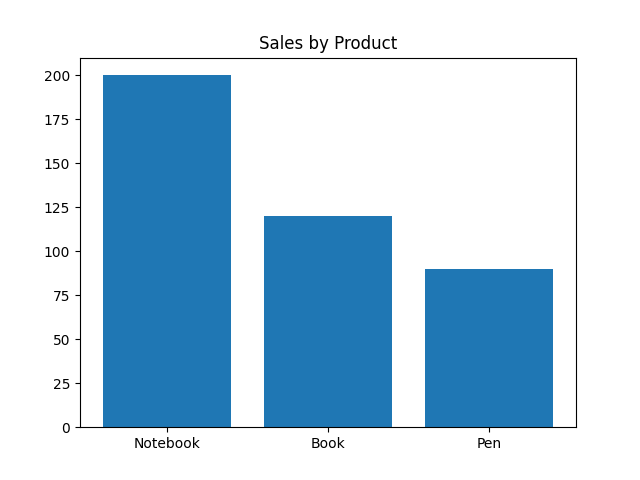

# Data Automation & Reporting

A small Python project that cleans a sample sales CSV, aggregates sales by product and saves a bar chart.

## Implemented workflow

1. Read `data/raw/sales_data.csv`.
2. Drop rows containing any missing value and normalize column names.
3. Save `data/cleaned/sales_data_clean.csv`.
4. Sum sales by product and save `reports/sales_by_product.png`.

The current implementation produces CSV and PNG files. Excel and PDF export are not implemented. Dropping every incomplete row is a simple demonstration rule, not a general-purpose data-quality policy.

## Installation and usage

From a terminal with Python available:

```powershell
git clone https://github.com/joelambga-cpu/data-automation-reports.git
cd data-automation-reports/data_automation_reports
python -m venv .venv
.\.venv\Scripts\python.exe -m pip install -r requirements.txt
.\.venv\Scripts\python.exe -m src.main
```

On macOS/Linux, replace `.\.venv\Scripts\python.exe` with `.venv/bin/python`.

## Preview



## Files

Source code, sample data and dependencies are inside [data_automation_reports](data_automation_reports/). Run commands from that application folder.
